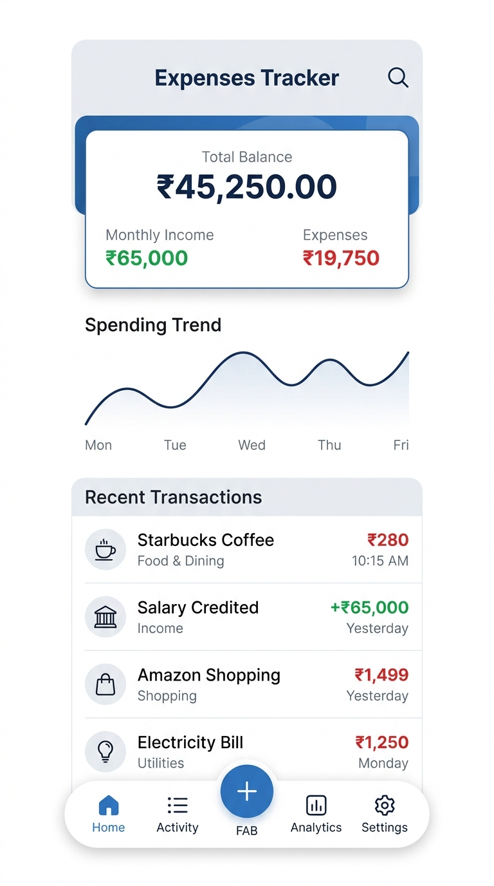
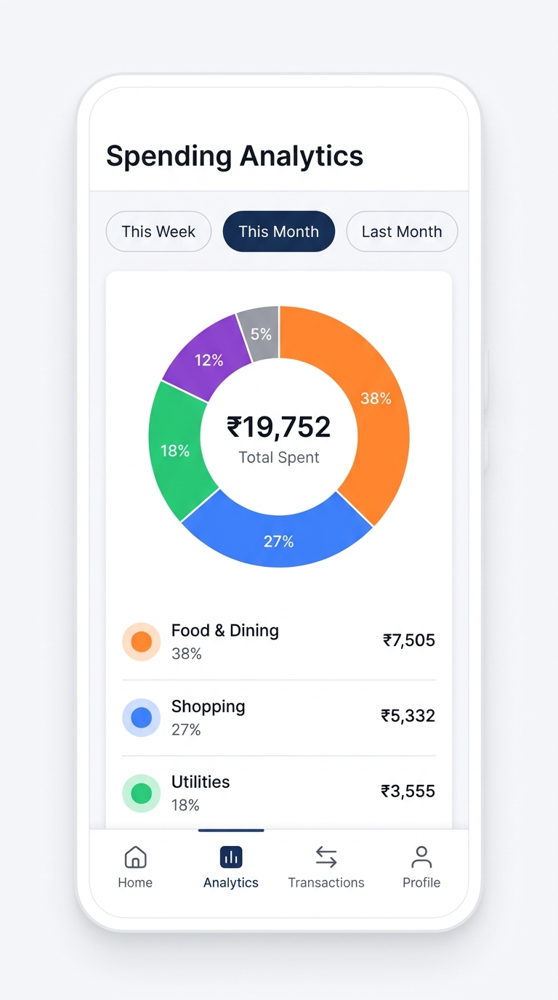
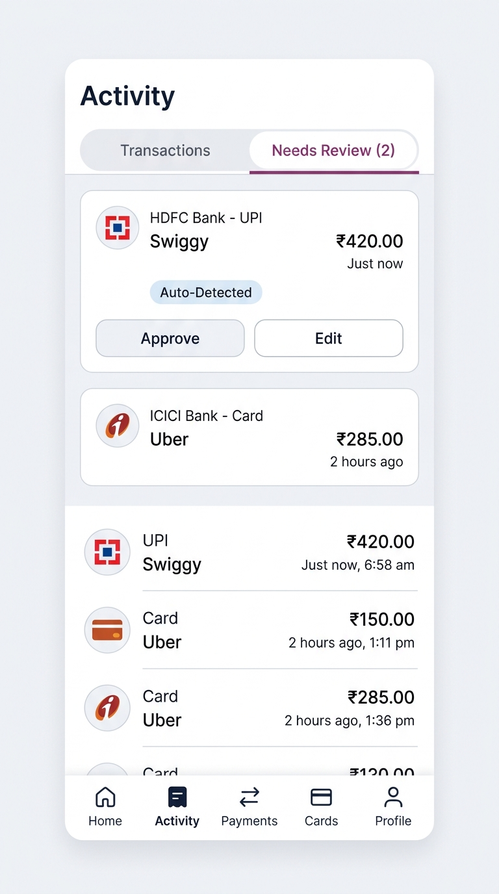
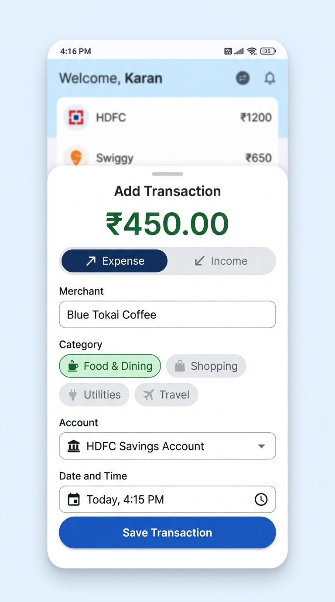

# Expenses Tracker

A simple, fast, and privacy-focused personal finance app built with Flutter. Expenses Tracker helps you understand your spending habits, manage multiple bank accounts and cash wallets, and automatically capture transactions from bank and UPI notifications—completely offline and encrypted on your device.

---

## 📱 App Highlights

| Dashboard & Overview | Spending Analytics |
| :---: | :---: |
|  |  |
| **Track total balance, monthly income, expenses & trends** | **Visual category breakdowns with interactive charts** |

| Smart Activity & Review | Quick Transaction Entry |
| :---: | :---: |
|  |  |
| **Auto-detect transactions from bank alerts with one-tap review** | **Easily log cash or manual expenses in seconds** |

---

## ✨ Features

- **⚡ Automatic Expense Tracking (Android)**  
  Reads incoming bank and payment notifications (UPI, cards, NetBanking) and turns them into organized transaction records automatically.

- **📥 Smart Review Inbox**  
  Transactions detected from notifications are placed in a simple review inbox so you can confirm or edit them with a single tap.

- **📊 Clear Visual Analytics**  
  Understand your money at a glance with colorful donut charts, monthly spending comparisons, and category insights (Food & Dining, Shopping, Utilities, Travel, and more).

- **💳 Multiple Accounts & Wallets**  
  Keep track of separate balances for your bank accounts, credit cards, debit cards, and cash wallets.

- **🔒 100% Private & Secure**  
  - **Offline-First**: None of your financial data ever leaves your phone.
  - **Encrypted Database**: All information is stored in an encrypted database (SQLCipher) on your device.
  - **Biometric Security**: Unlock the app using your fingerprint or face recognition.

- **⏰ Daily Reminders**  
  Set an optional daily notification at your preferred time to review your day's spending or add cash transactions.

- **📤 Spreadsheet Export**  
  Export your entire transaction ledger to CSV anytime to open in Google Sheets, Microsoft Excel, or keep as a backup.

---

## 🚀 How It Works

1. **Set Up Accounts**: Add your accounts (e.g., Bank account, Credit Card, or Cash Wallet) with your starting balance.
2. **Grant Notification Access (Optional)**: Allow the app to detect SMS and payment alerts from your bank to track expenses automatically.
3. **Monitor & Budget**: Open the dashboard to see your current net balance, review new purchases, and monitor your monthly budget.

---

## 🛠️ Getting Started

### Prerequisites
- [Flutter SDK](https://docs.flutter.dev/get-started/install) (v3.12 or newer)
- Android Studio / VS Code with Flutter extension
- An Android device or emulator (Android 8.0+ recommended for notification listener)

### Installation

1. **Clone the repository**:
   ```bash
   git clone https://github.com/CalvinNH/ExpenseTracker.git
   cd expense_tracker
   ```

2. **Install dependencies**:
   ```bash
   flutter pub get
   ```

3. **Run the app**:
   ```bash
   flutter run
   ```

---

## 🧰 Built With

- **Flutter & Material 3** – Clean, modern mobile user interface
- **SQLCipher & SQLite** – On-device, 256-bit encrypted database
- **FL Chart** – Responsive interactive charts and graphs
- **Local Auth** – Biometric authentication (fingerprint / face ID)
- **Share Plus & Path Provider** – Safe local CSV file export
